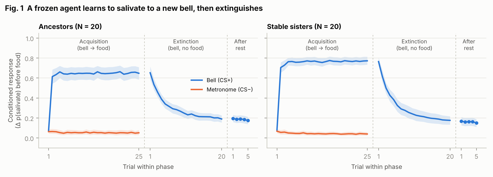
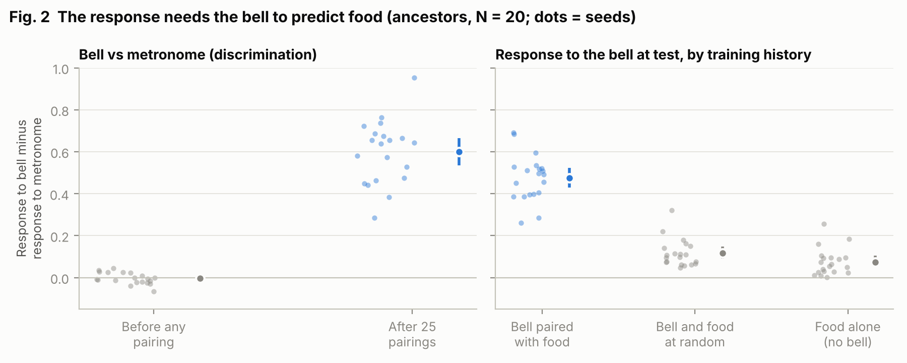
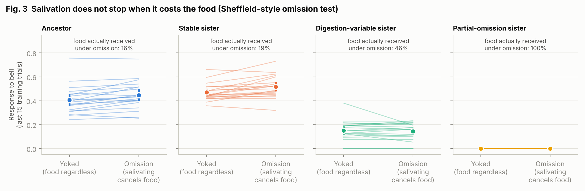
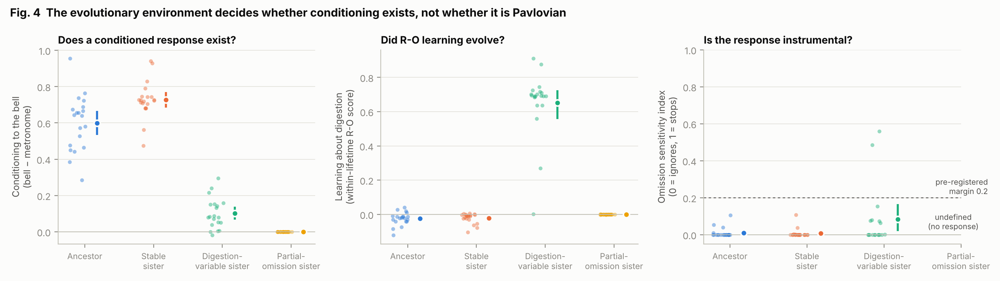
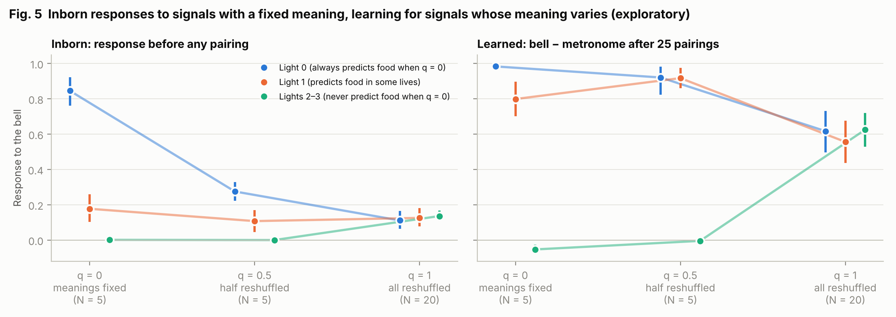
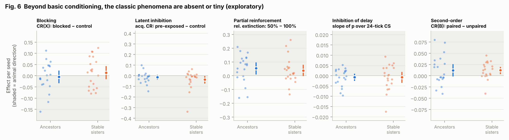

# Pavlov's dog as an evolved learner: ecological statistics determine when conditioning emerges, and why it ignores its consequences

*Draft v0.2 — 2026-11-19. Ronak Daniel. Working draft for internal review; not for circulation.*

> **Status notes for co-authors.**
> (1) References marked † were cited from memory and must be checked against the source before
> submission (see `docs/LITERATURE.md`). (2) Every number below is produced by a committed script
> from `results/`; the script is named next to each result. (3) Sections 2.1–2.3 are the
> pre-registered confirmatory results (git tag `prereg-v1`, commit `b4d07cf`); everything from 2.4 on is
> exploratory and labelled as such.

---

## Abstract

Pavlov's dogs salivated to a bell that predicted food, and later experiments showed that this
response persists even when salivating cancels the food. Why would such an "irrational" learned
response exist? We asked whether it emerges on its own in artificial agents whose only action is
salivation and whose only objective is physiological: saliva improves digestion and costs a little
energy. Recurrent neural agents were evolved (evolution strategies) over many simulated lifetimes in
an ecology where which cue predicted food changed from lifetime to lifetime. Nothing in the objective
referred to cues, and the laboratory tests were never part of evolution. Frozen and placed in a
simulated Pavlov laboratory with a bell they had never encountered, agents from 20 independent
evolutionary runs (all pre-registered) acquired a conditioned-response-like (CR-like) salivation to
the bell within a few pairings (bell − metronome discrimination 0.60, 95% CI [0.53, 0.67]; none
before pairing), which depended on the bell–food contingency rather than on mere exposure, partly
extinguished, and was insensitive to an omission contingency (omission sensitivity index 0.01
[0.00, 0.02]): agents kept salivating although this cost them 84% of the food. Evolving sister lineages under different
response–outcome statistics showed that ecology decides whether a CR exists, not whether it is
Pavlovian: lineages that evolved genuine within-lifetime learning about the digestive consequences
of salivating still ignored omission, and lineages in which salivating could cancel food abandoned
the CR altogether. Exploratory experiments indicate that an inborn response evolves to cues of fixed
meaning and within-lifetime conditioning to cues of variable meaning, that the learned association
is stored in a small, cue-specific subset of recurrent units, and that the evolved learner is fast
and non-competitive: unlike Rescorla–Wagner and temporal-difference models, it shows no blocking —
even after evolving in a world of compound cues to which it measurably adapted — and it shows no
latent inhibition, partial-reinforcement extinction effect or spontaneous recovery.

---

## 1. Introduction

Classical conditioning is usually described with two kinds of models. Prediction models such as
Rescorla–Wagner (RW)† and temporal-difference (TD) learning† explain how a conditioned stimulus (CS)
comes to predict an unconditioned stimulus (US). Agent models of "Pavlovian control" then attach a
fixed response to that prediction by construction (Modayil & Sutton 2014†; Butcher et al. 2022).
Both take the link between prediction and response as given. A functional view of conditioning
(Domjan 2005; Hollis 1997†) instead holds that conditioned responses exist because they improve how
an animal deals with the US — saliva secreted before food arrives speeds digestion. On this view the
prediction–response link is itself a product of evolution, and so is its most puzzling property:
in omission experiments (Sheffield 1965†; Williams & Williams 1969†), animals keep producing the
CR even when it cancels the US. Normative accounts explain this as a hard-wired, outcome-insensitive
"Pavlovian" controller that is usually right (Dayan et al. 2006†).

Theory of the evolution of learning predicts *when* learning should be favoured over fixed behaviour:
when the world varies between generations but is predictable within a lifetime (Stephens 1991†;
Katsnelson et al. 2012). Meta-reinforcement learning (meta-RL) gives a concrete way to test such
ideas: an outer optimisation loop over many lifetimes produces a recurrent network whose fixed
weights implement a within-lifetime learning algorithm in its activations (Wang et al. 2018†; Binz
et al. 2023†). Meta-learned agents have been compared with RW-type models in decision tasks
(Schubert et al. 2024), but, as far as we know, none has been taken through Pavlov's protocols or
an omission test.

We built such a test. The agent's only effector is salivation; its only consequence is
physiological. An outer loop (evolution strategies, the analogue of evolution) optimises digestion
over many lifetimes in an ecology where the meaning of cues varies between lifetimes. The inner
loop is a single lifetime with frozen weights, in which any learning must happen in recurrent
activity. We then freeze evolved agents and run them, blind, through a simulated Pavlov laboratory
that evolution never saw. We ask four questions: does a CR-like response to a novel bell emerge
(Q1)? Is it Pavlovian or instrumental, and what decides this (Q2)? Which of the classical phenomena
emerge (Q3)? How is it implemented (Q4)? Q1 and Q2 were tested in a pre-registered confirmatory
study with 20 independent evolutionary histories; Q3, Q4 and the role of cue-meaning variability are
exploratory.

**Spontaneity.** We call the CR spontaneous because (i) the objective is physiology only (reward
= energy from digestion − cost of salivating; it never references cues, trials or the lab), (ii)
salivation affects nothing but the saliva level, (iii) which channel predicts food is resampled every
lifetime so no channel — in particular not the lab's bell channel — has an innate meaning, (iv)
there are no auxiliary losses, (v) weights are frozen in the lab, and (vi) the lab protocols and the
omission contingency never occur during evolution. These invariants are enforced by tests in the
code base. What we do build in, and state openly, is the functional premise that saliva improves
digestion, and standard meta-RL inputs (food in the mouth, own saliva level, previous action and
reward).

---

## 2. Results

### 2.1 Evolved agents acquire a CR-like response to a novel bell (pre-registered, H1)

Evolved agents (20 "ancestor" lineages, 4000 generations each) achieved a training return of 13.3,
well above a fixed reflex that salivates only once food is in the mouth (11.6) and closing on average
57% of the gap between that reflex and the best cue-reading oracle (14.6); 17 of 20 met the
pre-registered training criterion of 50% (gate pass was not an inclusion criterion; all 20 were
analysed). In their training world they salivated with probability 0.43 in the ticks before an
expected US and 0.05 elsewhere (`scripts/eval_training.py`).

Frozen in the lab, agents met a bell (CS+) and a metronome (CS−) on two randomly chosen channels.
Before any pairing they responded to neither (bell − metronome −0.004 [−0.015, 0.008]). After the
bell had been paired with food, the response to the bell rose to asymptote within about two trials
and stayed there, while the response to the unpaired metronome did not (Fig. 1). Over the last 10
acquisition trials, bell − metronome discrimination was 0.60 [0.53, 0.67] (H1a; d_z = 3.9), and its
increase from the naive phase was 0.60 [0.54, 0.67] (H1b). The response required a predictive
relation: after the same bell and food exposure in a truly-random arrangement, the bell's CR was
0.36 [0.31, 0.41] lower than after pairing (H1c), and after food alone it was 0.40 [0.35, 0.46]
lower (H1d; Fig. 2). All four tests survived Holm–Bonferroni correction in a family of 11
(`scripts/analyze_confirmatory.py`; `results/confirm/analysis.md`).

**Figure 1.** Acquisition, extinction and post-rest test in frozen ancestors (left) and stable
sisters (right). Lines: mean CR over 20 seeds (each the mean of 32 lab subjects); bands: 95%
bootstrap CI. CR = mean p(salivate) in the 3 ticks before the US minus the 10 ticks before CS onset.

**Figure 2.** Discrimination before vs after pairing, and the bell's CR at test after pairing,
truly-random exposure, or food alone. Dots: seeds; large marker: mean with 95% CI.

### 2.2 The CR extinguishes and ignores its consequences (pre-registered, H3)

When the bell was presented without food, the CR declined to 0.20 over 20 trials, about a third of
its acquisition level (0.5·acquisition − extinction = 0.12 [0.08, 0.16], H3a). Extinction was
therefore partial, not complete.

In the omission test, a CS+ trial's food was cancelled whenever the agent salivated during the CS.
Each agent was paired with a yoked partner that received exactly the same cues and food with no
contingency. Agents salivated as much as their yoked partners, or slightly more (CR 0.45 vs 0.41;
Fig. 3), and consequently received only 16% of the food available. The omission sensitivity index
(OSI = 1 − CR_omission / CR_yoked, clipped to [0, 1]) was 0.010 [0.001, 0.023], below the
pre-registered margin of 0.2 (H3b). A positive contingency (food only if the agent salivated) had
no effect either (−0.003 [−0.009, 0.002], equivalent to zero within ±0.1, H3c). By these
criteria, the evolved CR is Pavlovian-like: it tracks the stimulus–outcome relation and ignores the
response–outcome relation.

**Figure 3.** CR in the omission condition vs the yoked partner, per arm. Lines: seeds.
Text: fraction of the available food actually received under omission.

### 2.3 Ecology decides whether a CR exists, not whether it is Pavlovian (pre-registered, H2′)

Our original hypothesis was that variability in response–outcome (R-O) relations across lifetimes
would select for outcome-sensitive, instrumental responding. Pilot studies did not support it, and
we replaced it before the confirmatory study with H2′, which is derived from the pilots and
disclosed as such (Section 4.1). Each ancestor was split into three sister lineages that evolved
for 2000 more generations (Fig. 4): a stable sister (same world), a digestion-variable sister (in
half of all lifetimes saliva *impaired* digestion, so the value of salivating had to be learned
within each life), and a partial-omission sister (in half of all lifetimes, salivating during a
predictive cue halved the chance of that trial's food).

Digestion-variable sisters evolved genuine within-lifetime R-O learning: in held-out lifetimes,
their probability of salivating with food in the mouth differed by 0.65 between normal and
impaired-digestion lifetimes, compared with −0.03 in their ancestors (difference 0.68 [0.58, 0.75],
H2′b). Their bell CR was weaker (discrimination 0.10 vs 0.73 in stable sisters) but still
omission-insensitive (OSI 0.08 [0.02, 0.17], n = 18 seeds with a defined OSI, H2′a). Partial-omission
sisters, in contrast, abandoned the CR: acquired discrimination was 0.000 in all 20 lineages
(difference from stable sisters −0.73 [−0.77, −0.68], H2′c; below 0.1, H2′d). Because these values
are near-deterministic, we report magnitudes rather than the very small p-values. In short,
evolution never produced an omission-sensitive CR: depending on the ecology it produced a Pavlovian
CR, a weaker Pavlovian CR alongside separate R-O learning, or no CR. All 11 pre-registered tests
were supported.

**Figure 4.** Per arm: conditioning strength, within-lifetime R-O learning, and OSI. Dots: seeds.

### 2.4 Fixed meanings produce inborn responses; variable meanings produce learning (exploratory)

All confirmatory agents evolved in a world where cue meanings were reshuffled every lifetime
(q = 1). To test whether this variability is what makes learning evolve, we evolved five ancestors
with fixed meanings (q = 0: channel 0 always predictive) and five with half the lifetimes reshuffled
(q = 0.5) (`scripts/run_svar.py`; predictions logged before the runs). At q = 0, agents salivated to
channel 0 the first time they encountered it (naive CR 0.85 [0.76, 0.92] vs 0.11 at q = 1): an inborn
response. Our pre-stated prediction that they would not learn about the other channels partly failed
(discrimination 0.37 on channels 1–3). Splitting by channel after the fact (Fig. 5) showed why:
channel 1 is a second predictive cue in half of all lifetimes even at q = 0, and agents learned it
readily (0.80), whereas they ignored channels 2–3, which never predict food at q = 0 (−0.05). The
same held at q = 0.5 (channel 1: 0.92; channels 2–3: −0.005), although channels 2–3 predict food in
roughly one lifetime in five there. Only at q = 1 did agents learn about every channel. This pattern —
inborn responses to reliably meaningful cues, learning for cues of variable but frequent relevance,
and neglect of rarely relevant cues — resembles selective associability ("preparedness") in animals.
It is post hoc for the channel split and based on N = 5 per level, so it calls for a dedicated test.

**Figure 5.** Naive (left) and acquired (right) response by bell channel and by how often cue meanings
were reshuffled during evolution (q).

### 2.5 The learned association lives in a few cue-specific recurrent units (exploratory)

Because weights are frozen, the association must be held in the recurrent state. A linear probe could
read out a model-light expectation of food from that state (held-out R² 0.59 [0.54, 0.64]), and the
decoded expectation was not lower under omission than in yoked partners (+0.017 [+0.006, +0.028]).
However, steering the state along the probe direction did not change salivation more than steering
along a random direction (`scripts/mechanism.py`), so this decodable expectation is not the causal
variable. Activation patching was more informative (`scripts/mechanism_patch.py`): transplanting the
8 most-changed of 64 units from a trained state into the same subject's naive trial transferred 76%
[61, 90] of the acquired CR, and 16 units transferred all of it. A trained state from *another*
subject whose bell was on the same channel transferred equally well (81% at 8 units), whereas one
from a subject trained on a different channel transferred nothing and reduced responding (−26%
[−40, −12] at 16 units). The association is therefore stored compactly, indexed by input channel,
and read the same way across individuals of one evolved network. The same pattern held in stable
sisters.

### 2.6 A fast, non-competitive learner: phenomena and baseline models (exploratory)

We ran a battery of later conditioning phenomena (designs and criteria fixed before running) and
the same protocols with three baseline learners (parameters fixed a priori): RW, TD with a complete
serial compound, and an instrumental Q-learner trained from scratch within the lab session
(`results/baselines/scorecard.md`; Fig. 6; Table 1).

None of the classical post-Pavlovian phenomena was clearly present in the ancestors. After A had
been trained, the added cue X of an AX compound gained as much CR as in an overshadowing control
(blocking −0.005 [−0.033, 0.023]), whereas RW and TD both showed strong blocking (−0.28, −0.16).
Pre-exposure did not slow acquisition (latent inhibition −0.015 [−0.037, 0.008]); learning reached
asymptote after one pairing in both groups, and pre-exposure only reduced the first-trial response.
Extinction after 50% reinforcement was not slower once terminal response levels were taken into
account (the ratio difference of +0.05 arises from a lower terminal CR after partial reinforcement).
Responding did not rise across a long, out-of-distribution CS of 24 ticks (slope −0.001), although
it rose slightly across an in-distribution 12-tick CS (+0.008 per tick). Second-order conditioning
was tiny (+0.012; reliable only in stable sisters, where the first-order CR was 0.75). There was no
spontaneous recovery after a rest. The instrumental Q-learner never acquired an anticipatory
response within a lab session.

**Table 1.** Agents (20 ancestors, mean [95% CI]) vs baseline learners on the same lab protocols.

| Measure | Animals | Agents | RW | TD | Instr. Q |
|---|---|---|---|---|---|
| Acquired discrimination | > 0 | 0.60 [0.53, 0.67] | 1.00 | 0.55 | −0.01 |
| Paired − truly random | > 0 | 0.36 [0.31, 0.41] | 0.48 | 0.59 | −0.03 |
| Extinction (end / acquisition) | < 1 | 0.33 [0.26, 0.42] | 0.00 | 0.60 | — |
| Spontaneous recovery | > 0 | −0.01 [−0.02, 0.00] | 0.00 | −0.05 | 0.00 |
| Omission (OSI) | ≈ 0 | 0.01 [0.00, 0.02] | 0 | 0 | undefined |
| Blocking | < 0 | −0.005 [−0.03, 0.02] | −0.28 | −0.16 | 0 |
| Latent inhibition | < 0 | −0.02 [−0.04, 0.01] | 0 | 0 | 0 |
| Inhibition of delay (slope) | > 0 | −0.001 [−0.003, 0.001] | 0 | +0.018 | 0 |
| Second-order conditioning | > 0 | 0.01 [−0.00, 0.03] | 0 | 0.01 | 0 |

**Figure 6.** Phenomena battery. Per-seed effects; the shaded half is the direction animals show.

### 2.7 Compound cues: adaptation without blocking (exploratory)

The ancestors' world presented one stimulus at a time, so cue competition could never pay, and the
absence of blocking might simply reflect that. We therefore evolved ten *compound sisters* from
ancestors 0–9 (seeds 140–149; 2000 generations, like the stable sisters) in the same world, except
that 30% of events added a second, randomly chosen channel (`configs/exp/compound.yaml`). Predictions
and the analysis script were committed before the run (`docs/DECISIONS.md`, 2026-11-19): (C1)
compound sisters show blocking, more than their stable sisters; (C2) they still condition
(discrimination > 0.3) and stay omission-insensitive (OSI < 0.2). If C1 failed, the missing compounds
would not explain the missing blocking.

All ten compound sisters passed the Phase-2 gate. C2 was supported, C1 was not (Table 2). The
redundant cue X gained as much CR after A had been trained as without (0.24 vs 0.23; blocking
+0.012 [−0.018, 0.044], wrong sign; compound − stable −0.002 [−0.065, 0.059], p = 0.96). A post-hoc
cross-evaluation (`scripts/compound_crosseval.py`, planned after C1 failed and before it was run)
ruled out the possibility that compounds simply exerted no selection pressure. On the same held-out lifetimes of the
compound world, compound sisters earned more than their stable sisters (+0.39 [0.30, 0.49],
p = 3·10⁻⁵), while in the ancestral world they earned slightly less (−0.10 [−0.21, −0.01], p = 0.09):
a specialist trade-off. Evolution adapted the learner to compounds, but not through
Rescorla–Wagner-like cue competition. Which adaptation it found was not investigated. Compound
sisters also showed a slightly flatter response across a 24-tick CS than their stable sisters
(−0.004 [−0.007, −0.001], p = 0.04, unadjusted); the other battery effects did not differ.

**Table 2.** Compound vs stable sisters of the same 10 ancestors (mean [95% CI]).

| Measure | Compound sisters | Stable sisters |
|---|---|---|
| Acquired discrimination | 0.67 [0.60, 0.75] | 0.75 [0.71, 0.80] |
| Omission (OSI) | 0.03 [0.00, 0.07] | 0.00 [0.00, 0.00] |
| Gap closed (gate ≥ 0.5) | 0.60 [0.58, 0.63] | 0.65 [0.62, 0.67] |
| Blocking (animals < 0) | +0.01 [−0.02, 0.04] | +0.01 [−0.02, 0.05] |
| Return in the compound world | 16.25 [16.17, 16.33] | 15.86 [15.80, 15.92] |
| Return in the ancestral world | 13.45 [13.38, 13.54] | 13.56 [13.49, 13.62] |

---

## 3. Discussion

Optimising nothing but digestion, over lifetimes in which cue meanings varied, produced agents that
reproduce the core of Pavlov's findings in a laboratory they had never seen: a response to a novel
bell that is acquired within a few pairings, depends on the bell–food contingency, extinguishes
partly, and — the property that makes the Pavlovian response puzzling — persists when it costs the
food. No component of the objective, the agent or its inputs referenced the bell–salivation relation.

**Why outcome-insensitivity?** In the evolutionary environment of the ancestors, salivating never
changed whether food came; it only changed how well food was digested. A response that follows the
food prediction and ignores its own consequences is then optimal, and this is what evolved. The
sister lineages sharpen this: even when evolution was given R-O variability, it did not produce an
omission-sensitive CR. When the variability concerned digestion, agents learned about digestion
separately while the bell response stayed Pavlovian; when salivating could cancel food, evolution
removed the bell response rather than bringing it under instrumental control, although an
instrumental policy would have paid more (pilot oracle analysis). A four-times larger search
(pilot, Section 4.1) did not change this, but we cannot exclude that a stronger search would find
the instrumental solution. The result supports the normative view that Pavlovian control is a
cheap, usually adequate default (Dayan et al. 2006†), and adds that in our setting it was the only
evolved form of anticipatory responding.

**When does learning evolve?** The exploratory cue-variability experiment matches classic
predictions (Stephens 1991†): fixed meanings produced an inborn response, variable meanings produced
learning. Agents also neglected cues that were relevant only rarely, a selective associability that
emerged without any built-in attention mechanism.

**What kind of learner is it?** The evolved learner is fast and channel-specific, and its memory is
compact: about 8–16 recurrent units carry a transferable, channel-indexed association. It does not
behave like an error-correcting associative model: it shows no blocking, which both RW and TD
predict strongly, and no latent inhibition or partial-reinforcement extinction effect. A world of one stimulus at a
time could explain this, but agents evolved with compound cues adapted to them and still did not
block (Section 2.7). Blocking is therefore not a by-product of being a good conditioner, even in a
world that contains compounds. Whether it needs a stronger pressure (the same redundant cue
throughout a lifetime, or costlier false alarms) or a different architecture is open. Latent
inhibition and the PREE may similarly need worlds in which contingencies change often.

**Limitations.** (i) The ecology is simple: four channels, delay conditioning, one physiological
consequence. (ii) The R-O families we tested are two of many. (iii) Several lab conditions are out
of distribution (compounds, long CSs, long rests; `docs/OOD_TABLE.md`). (iv) Exploratory results
(2.4–2.7) use fewer seeds (e.g. 10 compound sisters on development seeds) or post-hoc splits and
need confirmation; the compound world used a single design (p = 0.3, random second channel). (v) The baseline models use
textbook parameters, which were not fitted. (vi) We claim CR-like behaviour and Pavlovian-like
signatures, not any equivalence of mechanism or experience with animals.

---

## 4. Methods

### 4.1 Pre-registration, pilots and disclosed deviations

Pilot studies used seeds 100–199; confirmatory seeds 0–99 were technically locked until the
pre-registration was frozen (git tag `prereg-v1`, commit `b4d07cf`, 2026-11-16). All design decisions
and failed runs are logged in `docs/DECISIONS.md`. Deviations from the draft pre-registration, all
made before any confirmatory run: (1) H2 (R-O variability → omission sensitivity) was replaced by
H2′ because it failed in every pilot lineage and family, including a 4× larger search (pop 256,
32 lifetimes per member); (2) trial windows were aligned with the implemented protocols; (3) a test
window (`ext_cs_plus_first5`) was defined after seeing pilot data so the paired test matches the
controls' five unreinforced trials. The outer loop was switched from recurrent PPO (which failed the
training criterion) to evolution strategies during the pilots.

### 4.2 Physiology and reward

Saliva S_t ∈ [0, 1) follows S_{t+1} = S_t + k_up·u_t·(1 − S_t) − k_down·S_t with k_up = 0.35 and
k_down = 0.15, where u_t ∈ {0, 1} is the sampled salivation action. A food item stays in the mouth
for D = 3 ticks and yields energy (E/D)·[b0 + (1 − b0)·S_t] per tick (E = 1, b0 = 0.3). Reward is
r_t = energy_t − c·u_t with c = 0.01. These values were fixed by an oracle analysis of the physiology
alone (anticipatory salivation must pay), never by lab metrics.

### 4.3 Ecology

A lifetime lasts 3000 ticks. There are four cue channels and one stimulus at a time; events start
at a per-tick rate drawn per lifetime from U(1/40, 1/20). In each lifetime one predictive cue (two
with probability 0.5) predicts food at an ISI drawn from {3, …, 12} with contingency P(US | CS) drawn
from U(0.5, 1); all channels, predictive or not, share the same temporal statistics. Cues are delay
cues (on through the US tick). With probability q (q = 1 in all confirmatory runs), the mapping from
cue roles to channels is randomly permuted for the lifetime. Predictive cues toggle between active
and silent with hazard 1/1500 per tick and revert to their original contingency with probability
0.5 when reactivated; unsignalled food occurs at up to 0.005 per tick. Sister arms add, in a
fraction v = 0.5 of lifetimes, either impaired digestion (efficiency b0·(1 − S_t), equal to the
normal efficiency at S = 0) or a partial-omission gate (salivating during a predictive cue's window
halves that trial's US probability).

### 4.4 Agent and outer loop

The agent is a GRU (64 units) over a 64-unit tanh embedding of [cues, food in mouth, S_t, u_{t−1},
r_{t−1}], with a Bernoulli salivation head and a value head (not used by the evolutionary outer loop).
There are no auxiliary losses. Weights were optimised with OpenAI evolution strategies (Salimans et al. 2017†): antithetic
sampling, centred-rank fitness shaping, population 64, 8 lifetimes per member, σ = 0.03, Adam with
learning rate 0.02 and weight decay 0.005, common random numbers within antithetic pairs. Ancestors
evolved for 4000 generations from scratch; sisters for 2000 generations from the ancestor's
generation-4000 weights with a fresh optimiser state. Training was checkpointed every 100
generations and resumed exactly after interruptions.

### 4.5 Laboratory

Agents were frozen (no optimiser is reachable from the lab code). Each protocol ran 32 subjects,
each starting from a zero hidden state, with schedules fixed by a lab seed (2026) and therefore
identical for every agent. Bell and metronome were assigned to two random channels per subject.
CS duration was 6 ticks plus the US tick; inter-trial intervals U{15, …, 35}. Every protocol began
with 4 bell and 4 metronome trials without food. Protocols: standard (25 paired bell + 25 metronome
trials, 20 extinction trials, 300 empty ticks, 5 recovery trials); truly random; bell alone; food
alone; omission (40 bell trials with food cancelled if the agent salivated during the CS, plus 20
metronome trials) with a yoked partner receiving identical cues and food; positive contingency with a
yoked partner. The CR on a trial is the mean salivation probability over the 3 ticks before the
(would-be) US minus the mean over the 10 ticks before CS onset. The lab scheduler cannot read agent
outputs; the only route from behaviour to the schedule is the declared contingency.

### 4.6 Statistics

The unit of analysis is the evolutionary seed (N = 20); lab measures are means over the 32 subjects.
The 11 confirmatory tests formed one Holm–Bonferroni family (α = 0.05); two-tailed tests counted only
in the predicted direction; bounds and equivalence were tested with one-sided t-tests and TOST.
Effect sizes are means with 95% percentile bootstrap CIs (10,000 resamples) and Cohen's d_z. No
seed was excluded. Exploratory analyses are described with their scripts; their plans were logged
before they were run, and post-hoc analyses are marked as such.

### 4.7 Exploratory analyses

*Cue-meaning variability:* 5 ancestors each at q = 0 (seeds 130–134) and q = 0.5 (135–139), trained as
the confirmatory ancestors. *Mechanism:* hidden states were reconstructed by re-running the frozen
network on the recorded observations (maximum error in p(salivate) 2.4·10⁻⁴); probe = ridge regression
on held-out subjects; patching replaced the top-k units (ranked by mean |donor − recipient|) at the
tick before the first naive CS+. *Phenomena:* between-subject designs with 32 subjects per group;
blocking (A+ ×20, AX+ ×10, X test vs a B-pretrained control), latent inhibition (A− ×20 then A+ ×10
vs B pre-exposure), PREE (100% vs 50% reinforcement, equal US count, then 20 extinction trials),
inhibition of delay (24- and 12-tick CS), second-order conditioning (A+, then B→A, vs unpaired B).
*Compound cues:* `p_compound` = 0.3; when an event starts, with this probability a second
channel, drawn uniformly from the other three, starts at the same tick (separate random stream, so
p_compound = 0 reproduces the original world exactly). Cross-evaluation used 256 held-out lifetimes
per world, identical for every agent.
*Baselines:* RW (α = 0.3), TD(0) with a complete serial compound (α = 0.1, γ = 0.9), tabular
Q-learning on physiological reward (α = 0.2, γ = 0.9, softmax β = 5); all with a food reflex.

### 4.8 Code and data availability

All code, configurations, logs, lab outputs, final checkpoints and the decision log are in the
project repository. Figures are regenerated from `results/` by `scripts/make_figures.py`.

---

## References

(† = not yet verified against the source; see `docs/LITERATURE.md`.)

- Binz, M. et al. (2023). Meta-learned models of cognition. *Behavioral and Brain Sciences*. †
- Butcher, J., Pilarski, P. M. et al. (2022). Frost Hollow: Pavlovian signalling. arXiv:2203.09498.
- Dayan, P., Niv, Y., Seymour, B. & Daw, N. D. (2006). The misbehavior of value and the discipline of the will. *Neural Networks*. †
- Domjan, M. (2005). Pavlovian conditioning: a functional perspective. *Annual Review of Psychology*, 56. doi:10.1146/annurev.psych.55.090902.141409
- Hollis, K. L. (1997). Contemporary research on Pavlovian conditioning: a "new" functional analysis. *American Psychologist*. †
- Kamin, L. J. (1969). Predictability, surprise, attention, and conditioning. †
- Katsnelson, E. et al. (2012). *Proceedings of the Royal Society B*. †(title)
- Lubow, R. E. & Moore, A. U. (1959). Latent inhibition. †
- Modayil, J. & Sutton, R. S. (2014). Prediction driven behavior: learning predictions that drive fixed responses. †
- Pavlov, I. P. (1927). *Conditioned Reflexes*. Oxford University Press.
- Rescorla, R. A. (1967). Pavlovian conditioning and its proper control procedures. *Psychological Review*. †
- Rescorla, R. A. & Wagner, A. R. (1972). A theory of Pavlovian conditioning. †
- Salimans, T., Ho, J., Chen, X., Sidor, S. & Sutskever, I. (2017). Evolution strategies as a scalable alternative to reinforcement learning. arXiv:1703.03864. †
- Schubert, J. A., Jagadish, A. K., Binz, M. & Schulz, E. (2024). arXiv:2402.03969.
- Sheffield, F. D. (1965). Relation between classical conditioning and instrumental learning. †
- Stephens, D. W. (1991). Change, regularity, and value in the evolution of animal learning. *Behavioral Ecology*. †
- Sutton, R. S. & Barto, A. G. (1990). Time-derivative models of Pavlovian reinforcement. †
- Wang, J. X. et al. (2018). Prefrontal cortex as a meta-reinforcement learning system. *Nature Neuroscience*. †
- Williams, D. R. & Williams, H. (1969). Auto-maintenance in the pigeon. *Journal of the Experimental Analysis of Behavior*. †
